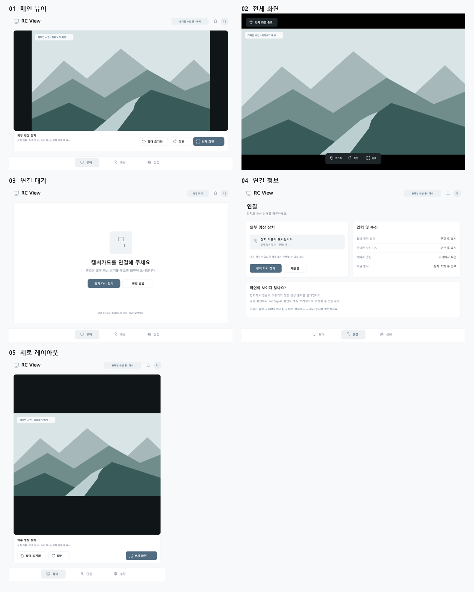

# RC View

개인용 **iPad 외부 UVC 영상 뷰어**. 캡처카드 연결 → 영상 확인 → 전체 화면.

SwiftUI + AVFoundation, iPadOS 17 이상, USB-C iPad 대상입니다. Windows에서 편집하고 GitHub Actions의 macOS 실행기로 **서명되지 않은 IPA**를 만든 다음, Windows의 Sideloadly에서 본인의 무료 Apple 계정으로 서명·설치합니다.

> **현재 검증 범위:** 이 작업 환경은 Windows입니다. 프로젝트 구조·설정과 로컬 정적 검사를 수행할 수 있지만 Xcode 빌드, iPad 설치, UVC 캡처카드 입력은 아직 검증하지 않았습니다. GitHub Actions의 빌드/테스트 성공과 `docs/TESTING.md`의 실기기 확인이 필요합니다. Apple 계정 비밀번호는 프로젝트나 GitHub에 넣지 않습니다.



## 시작

1. [Windows → GitHub Actions → Sideloadly 설치 안내](docs/INSTALL-WINDOWS.md)를 따라 저장소와 빌드를 준비합니다.
2. Actions에서 `Build RC View IPA` 워크플로를 수동 실행합니다.
3. 성공한 실행의 IPA artifact를 다운로드하고 ZIP을 풉니다.
4. `RCView-unsigned.ipa`를 Sideloadly로 iPad에 설치합니다.
5. 카메라 접근을 허용하고 UVC 캡처카드를 연결합니다.

## 기능

- 외부 UVC 장치만 검색. 내장 카메라로 자동 전환하지 않습니다.
- 단일 장치 자동 미리보기, 여러 장치 선택, 연결/해제/재연결 처리.
- 실제 장치가 제공하는 해상도·프레임률 선택, 활성 형식과 관측된 수신 FPS 표시.
- 비율 유지/화면 채우기, 핀치 확대와 초기화, 90도 표시 회전.
- 전체 화면, 터치 시 조작부 표시, 약 3초 후 자동 숨김.
- 카메라 권한·프레임 대기·수신 중단·세션 오류를 별도로 표시.
- 화면 꺼짐 방지, 자동 미리보기·전체 화면 설정, 로컬 연결 이력.
- 시뮬레이터에서만 교체되는 명시적인 데모 서비스.
- 로그인, 구독, 녹화, 오디오 입력, 네트워크 전송 없음.

## 하드웨어 전제

```text
실제 영상 출력이 확인된 원본 기기
  → HDMI 출력 케이블/어댑터
  → HDMI 입력 / USB 출력 UVC 캡처카드
  → USB-C iPad
```

- **DJI RC 2의 USB-C 영상 출력 가능 여부를 이 프로젝트가 보장하지 않습니다.** 해당 조종기·펌웨어·어댑터에서 실제 영상 출력을 먼저 확인해야 합니다.
- 일반 USB-C→HDMI 출력 어댑터만으로 iPad에 영상을 입력할 수 없습니다.
- 캡처카드가 검은 화면이나 자체 `No Signal` 화면을 송출해도 프레임은 수신될 수 있습니다. 앱은 이를 원본 신호 정상으로 단정하지 않습니다.
- 앱의 터치는 영상 표시만 변경하며 드론/조종기를 제어하지 않습니다.
- 대상 iPad 모델과 캡처카드 모델은 아직 지정/실측되지 않았습니다. 모든 UVC 장치의 호환성을 보장하지 않습니다.

## 폴더

| 경로 | 내용 |
|---|---|
| `RCView/Core` | 상태/형식 모델, 프레임 도착 관측, UI 모델 |
| `RCView/Capture` | 외부 AVFoundation 입력, 모의 입력 서비스 |
| `RCView/UI` | SwiftUI 화면, 네이티브 미리보기 레이어, 공통 컴포넌트 |
| `RCView.xcodeproj` | 체크인된 Xcode 프로젝트와 공유 Scheme |
| `.github/workflows` | 무료 표준 macOS 실행기 빌드/검증 |
| `scripts` | 프로젝트 재생성, 검증, 빌드/패키징 도구 |
| `Tests` | Xcode에서 실행하는 의미 기반 단위 테스트 |
| `design` | 디자인 토큰, 다섯 화면의 2배 해상도 PNG, 재생성 코드 |
| `docs` | 설치·아키텍처·실기기 시험·디자인 설명 |

## Windows 로컬 검사

Python 3가 설치되어 있다면 프로젝트 루트에서 실행합니다.

```powershell
py -3 scripts/generate_project.py
py -3 scripts/validate_project.py
```

Swift 파일을 추가하거나 삭제했다면 프로젝트를 다시 생성한 뒤 `.xcodeproj` 변경도 함께 업로드합니다. 로컬 검사는 Swift 컴파일이나 실기기 검사를 대신하지 않습니다.

## 관련 문서

- [설치 및 무료 갱신](docs/INSTALL-WINDOWS.md)
- [실기기 테스트와 검증 상태](docs/TESTING.md)
- [이번 작업의 로컬 검증 기록](docs/VALIDATION.md)
- [구조와 상태 처리](docs/ARCHITECTURE.md)
- [디자인 토큰과 인터랙션](docs/DESIGN.md)
- [Apple 외부 UVC 카메라 설명](https://developer.apple.com/videos/play/wwdc2023/10106/)
- [DJI RC 2 공식 FAQ](https://www.dji.com/rc-2/faq)

이 앱은 DJI의 공식 앱이 아니며 DJI SDK를 사용하지 않습니다.
